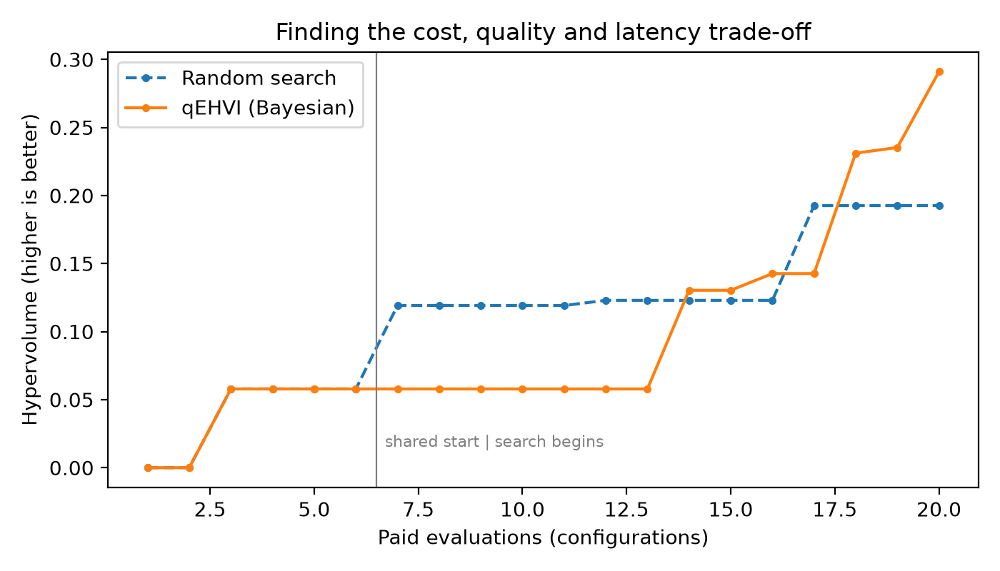

# LLM pipeline cost optimiser

"Cut our AI bill" sounds like one number. It is three: cost, answer quality and latency. Every
saving is a trade, and most teams make it blind. This project measures the trade-off for a
question answering and summarisation pipeline, finds the configurations where nothing can be
improved without hurting something else (the Pareto front) using Bayesian multi-objective
optimisation, and recommends one for a client's priorities.

- **Interactive page:** run locally (see [Run it](#run-it)); a Dockerfile is included for deployment
- Scoping: [docs/scoping.md](docs/scoping.md)
- Decisions: [docs/decisions](docs/decisions)

## Results

| Option | Quality | Cost per 1,000 requests | p95 latency |
|---|---|---|---|
| Current setup: Sonnet, plain prompt, full context | 82% | $4.74 | 4.2s |
| **Same quality, 16% cheaper:** Sonnet, grounded prompt, 60% of context | 85% | $3.96 | 4.2s |
| Best quality: Sonnet, grounded prompt, full context | 88% | $4.75 | 4.2s |
| **95% cheaper:** Haiku, plain prompt, full context, low effort | 68% | $0.24 | 3.7s |

Quality = share of requests that got a complete answer with no hallucination. With 60 test
requests each figure carries about ±8 points of uncertainty, so 82% vs 85% is "the same quality".



With the same 20 paid evaluations, Bayesian search (qLogEHVI) mapped **51% more of the trade-off
space** than random search (hypervolume 0.29 vs 0.19).

The whole study cost **$8.65** in API calls (3,992 calls, all cached so nothing is paid twice).

## How it works

```
RAGTruth (60 sources: 30 QA, 30 news summaries)
   │
   ▼
Pipeline runner ── 108 configurations = model × prompt × context kept × answer limit × effort
   │   records tokens, cost and latency per call
   ▼
Hallucination judge (Claude Haiku 5.5, calibrated against human labels)
   │
   ▼
Objectives: quality ↑   cost ↓   p95 latency ↓      guard rail: refusal rate
   │
   ├── Random search (control)
   └── Bayesian search: one GP per objective + qLogEHVI over all untested configurations
   │
   ▼
Pareto front → recommender (client limits + priority weights) → web page + plain English explanation
```

| Step | Code | Decision record |
|---|---|---|
| Data and judge calibration | `data.py`, `judge.py`, `calibrate_judge.py` | [0001](docs/decisions/0001-ragtruth-as-ground-truth.md), [0003](docs/decisions/0003-judge-choice.md) |
| Pipeline runner | `pipeline.py`, `llm.py` | [0004](docs/decisions/0004-pipeline-design.md) |
| Quality metric | `pipeline.py` | [0005](docs/decisions/0005-quality-means-complete-and-faithful.md) |
| Search | `moo.py`, `search_random.py`, `search_qehvi.py`, `compare.py` | [0002](docs/decisions/0002-bayesian-moo-over-evolutionary.md), [0006](docs/decisions/0006-discrete-qehvi.md) |
| Recommendation and web app | `recommend.py`, `export.py`, `app.py`, `web/` | |

## What I learned

**1. The cheapest judge agreed with humans the most.** Calibrated on 200 human labelled responses:

| Judge | F1 | Cohen's kappa | $ per 1,000 judgements |
|---|---|---|---|
| Haiku 5.5 | 0.83 | 0.63 | $0.35 |
| Sonnet 5.5 | 0.79 | 0.50 | $4.48 |
| Opus 5.5 | 0.79 | 0.51 | $9.97 |

Larger judges were stricter, not worse: 25 responses flagged by all three judges but labelled
clean by humans contain real unsupported claims on inspection. The human labels miss some
hallucinations.

**2. My first result was too good, and that was the most useful finding.** The first search put
the cheapest configurations at 100% faithfulness. Two things were gaming the metric: answers cut
off at the token limit contain no false claims, and an "extract then answer" prompt that never
reached its answer left only quotes copied from the source. The root cause was hidden reasoning
tokens: a capped Haiku answer billed ~339 output tokens of which only ~28 were visible text.
Quality now requires a complete answer ([ADR 0005](docs/decisions/0005-quality-means-complete-and-faithful.md)).

**3. A grounding instruction is the cheapest quality lever.** Every Pareto optimal Sonnet setup
uses the grounded prompt, which costs nothing extra.

**4. The starting design matters for Bayesian optimisation.** The 6 shared starting
configurations never included a 512 token limit or low effort, so the Gaussian processes could
not learn that those help. Random search led until evaluation 14; the Bayesian search overtook it
once it found them.

## Run it

```bash
uv sync
cp .env.example .env                                   # add ANTHROPIC_API_KEY
# RAGTruth: clone https://github.com/ParticleMedia/RAGTruth into data/RAGTruth
uv run python -m src.costopt.calibrate_judge --models haiku sonnet opus
uv run python -m src.costopt.pipeline --baseline
uv run python -m src.costopt.search_random --budget 20
uv run python -m src.costopt.search_qehvi --budget 20
uv run python -m src.costopt.compare                   # hypervolume chart and fronts
uv run python -m src.costopt.recommend --min-quality 0.8
uv run python -m src.costopt.export && uv run uvicorn src.costopt.app:app --reload
uv run pytest
```

The deployed app serves precomputed results (`web/results.json`): no API key, no per visitor cost.

## Limitations and next steps

- 60 requests per configuration: about ±8 points of uncertainty on quality. More requests, or
  repeated runs of the front, would tighten the claims.
- One run per search method. Several seeds would make "Bayesian beats random" a statistical claim.
- A balanced starting design (every setting value seen at least once) and a 1,024 token limit
  are the obvious next experiments; Haiku's quality is limited mostly by truncated answers.
- RAGTruth labels come from 2023 era models, and the judge itself is about 83% accurate.
- Prices are list prices for November 2026 (`pricing.py`).
